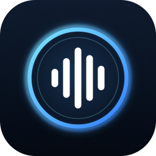

<div align="center">



# Jarvis Simple

**Voice transcription for your Mac. Speak, and the text appears at your cursor, in any app,
including the terminal. On-device, free, no account.**

[](#install)
[](#how-it-works)
[](#privacy)
[](LICENSE)

</div>

## What it is

Jarvis Simple turns your voice into text, and that is all it does. Put the cursor anywhere, press a
shortcut, talk, and the text lands there.

I use it to talk to AI tools instead of typing to them: coding agents in the terminal, chat
windows, Slack, notes. Speaking is several times faster than typing, so I can get a whole thought
and its context out quickly, check the answer, and keep going. A small recognition error rarely
matters when the reader is an AI model.

## Features

- **Text at the cursor, in any app.** Native apps, browsers, Electron apps (VS Code, Slack) and
  terminals. Your clipboard is restored afterwards. A clipboard-only mode is available too.
- **Mixed languages.** The language is detected for each phrase, so you can switch between, say,
  Czech and English mid-sentence without changing any setting. Supported: Czech, English, Slovak,
  German, Spanish, French, Italian, Polish, Portuguese, Russian, Ukrainian.
- **Fast.** Speech is transcribed while you are still talking; the text is in place about a second
  after you stop.
- **Private.** Recognition runs on your Mac's Neural Engine (Whisper large-v3-turbo). No audio or
  text ever leaves the computer.
- **Free.** No subscription, no word limit, no account, open source.

## Install

You need an Apple Silicon Mac with macOS 26 or newer, Xcode 26 and [Homebrew](https://brew.sh).
The app is built and signed on your own Mac.

```bash
brew install xcodegen
git clone https://github.com/ladronix/jarvis-simple.git && cd jarvis-simple
scripts/make-dev-cert.sh          # once per Mac: creates a local signing certificate
scripts/package.sh --install      # builds the app and installs it to /Applications
```

On first launch, allow **Microphone** and **Accessibility** when asked
(System Settings → Privacy & Security). The speech model (about 1.6 GB) downloads once; the
first start takes a minute or two while macOS prepares it, later starts take seconds.

To update: `git pull` and run `scripts/package.sh --install` again. Permissions stay granted.

## Use

| | |
|---|---|
| Start recording | **⌘ ;** — or hold **⌃ ⌥ Space** while you speak |
| Stop and insert | **⌘ '** — or release **⌃ ⌥ Space** |
| Cancel | **⌘ .** |

1. Click where the text should go (a terminal, a chat box, a document).
2. Start recording and speak.
3. Stop. A sound confirms the text was inserted.

Shortcuts, microphone, languages, a vocabulary list (names and terms the model should spell
correctly) and launch at login are in Settings, from the menu-bar icon.

## Privacy

Audio stays in memory and is discarded after each recording. Transcripts are never stored or
logged. The only network access is the one-time model download from huggingface.co. No
analytics, no accounts. Details in [PRIVACY.md](PRIVACY.md).

## How it works

```
microphone ─► voice activity detection ─► Whisper on the Neural Engine ─► text at the cursor
              (splits speech at pauses)     (language detected per chunk)   (Accessibility or ⌘V)
```

Built with Swift and SwiftUI on [WhisperKit](https://github.com/argmaxinc/argmax-oss-swift) and
[FluidAudio](https://github.com/FluidInference/FluidAudio) (Silero VAD).

## Development

```bash
cd Core && swift build && swift test    # core library, CLI and tests
scripts/lint.sh                         # swift-format
scripts/build.sh Debug --open           # Debug build of the app
```

See [AGENTS.md](AGENTS.md) for the code layout and runtime notes.

## Feedback

Found a problem? Use **Report an Issue…** in the menu, or open an
[issue](https://github.com/ladronix/jarvis-simple/issues).

## License

[MIT](LICENSE)
